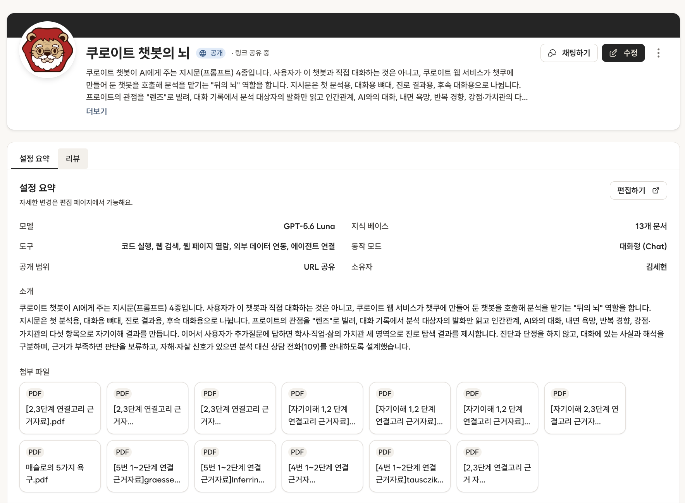

# 챗쿠 챗봇 참고 자료 (심사 참고용)

이 폴더는 쿠로이트 웹 서비스가 호출하는 **챗쿠 챗봇("쿠로이트 챗봇의 뇌")** 의 설정을 보여 주기 위한 참고 자료입니다.
웹사이트 코드(`streamlit_app_Freud.py`, `kstats.py`)는 이 폴더의 파일을 읽지 않으므로 서비스 동작에는 영향이 없습니다.

## 챗쿠 챗봇의 역할

사용자가 이 챗봇과 직접 대화하는 것은 아닙니다. 쿠로이트 웹 서비스가 챗쿠에 만들어 둔 챗봇을 호출해 분석을 맡기는 "뒤의 뇌" 역할을 합니다.
챗봇 호출이 실패하면 웹 서비스가 코드에 포함된 프롬프트로 다른 모델을 호출하는 대체 경로가 동작합니다.

## 챗봇 설정 화면

## 구성

| 파일 | 내용 |
|---|---|
| [`chatku_chatbot_settings.png`](chatku_chatbot_settings.png) | 챗쿠 챗봇 설정 화면 (모델, 도구, 지식 베이스, 소개, 첨부 문서) |
| [`chatku_prompts.txt`](chatku_prompts.txt) | 챗봇에 넣은 프롬프트 4종 (ANALYST_SYSTEM, CHAT_SYSTEM, CAREER_MODE, FOLLOWUP_MODE) |
| 근거 자료 폴더 | [Google Drive: 프로이트챗봇참고자료](https://drive.google.com/drive/folders/1MLf4rK5Rg54X2m5fuKSXU_fHjJqjSq2U) (챗봇 지식 베이스에 첨부한 근거 논문 PDF 13개) |

## 프롬프트 4종

- **ANALYST_SYSTEM**: 첫 분석용. 분석 대상자의 발화만 읽고 인간관계, AI와의 대화, 내면 욕망, 반복 경향, 강점·가치관의 다섯 항목(A~E)으로 자기이해 결과와 진로용 추가질문을 JSON으로 만듭니다.
- **CHAT_SYSTEM**: 대화용 뼈대. 분석 결과를 바탕으로 사용자와 대화할 때의 공통 원칙과 말투입니다.
- **CAREER_MODE**: 진로 결과용. 추가질문 답변을 반영해 학사·직업·삶의 가치관 세 영역의 후보, 근거, 작은 실험을 JSON으로 냅니다.
- **FOLLOWUP_MODE**: 후속 대화용. 진로 결과를 낸 뒤의 질문에 6문장 이내로 답합니다.

## 설계 원칙

- 임상 진단과 단정을 하지 않습니다.
- 대화에 있는 사실(observation)과 해석(hypothesis)을 구분합니다.
- 근거는 대화에서 직접 인용하고, 근거가 부족하면 판단을 보류합니다.
- 자해·자살 신호가 있으면 분석 대신 공감 문장과 상담 전화(109) 안내만 합니다.
- 첨부 근거 논문은 해석 기준을 확인하는 용도로만 쓰고, 분석문에는 논문명·저자를 쓰지 않습니다.
- 학사 제도·규정은 연결된 에이전트(자유전공학부 안내봇, 학사봇)가 돌려준 내용만 씁니다.
